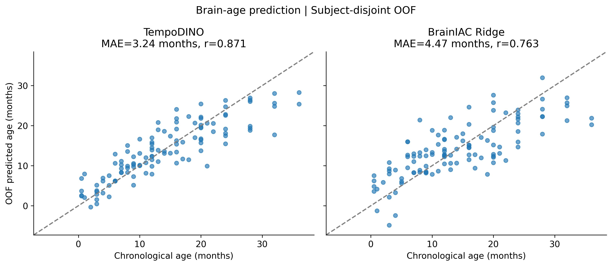
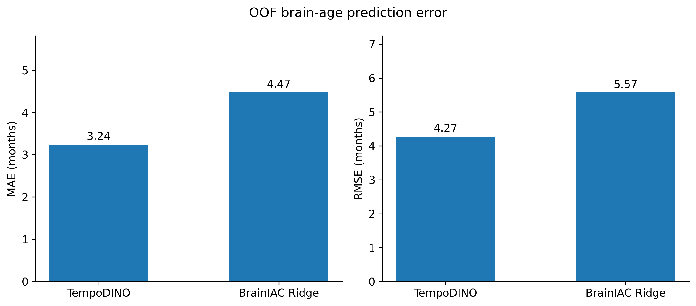
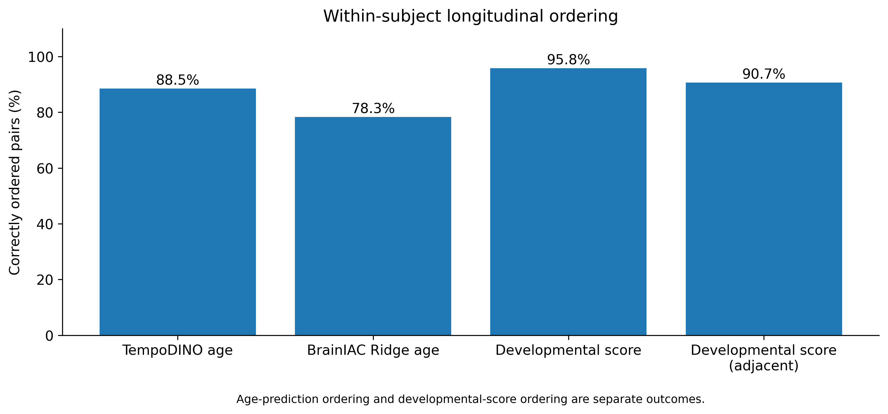
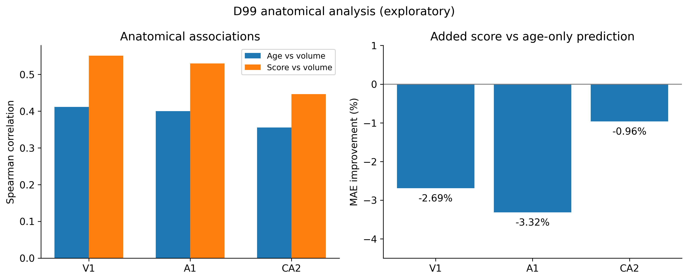

# TempoDINO: Learning a Continuous Developmental Axis from Longitudinal 3D Brain MRI

**Longitudinal non-human-primate brain MRI · 3D ResNet-18 · DINO self-distillation · Developmental geometry · Subject-disjoint OOF evaluation**

TempoDINO-v7 learns a **continuous developmental representation**, rather than optimizing directly for chronological-age regression. A single scalar developmental head is constrained by within-subject temporal ordering and cross-subject ordinal alignment; a separate projector learns relative temporal spacing. The 3D MRI encoder is initialized from fold-specific TempoDINO-v6 checkpoints.

## Study at a glance

- **114** longitudinal 3D T1 MRI scans, **23** subjects, **5** subject-disjoint held-out folds.
- **5-fold locked `v7_final`** OOF evaluation, no post-hoc fold-specific checkpoint selection.
- Code release focuses on the original V7 training and OOF aggregation programs; the local probe script must be added before full inference reproduction.

## Locked out-of-fold results

| Metric | OOF result |
|---|---:|
| Within-subject ordering accuracy | **95.58%** |
| Cross-subject ordering accuracy | **89.79%** |
| Subject developmental monotonicity | 95.54% |
| Subject consecutive-order accuracy | 90.22% |
| Global relative spacing accuracy | 87.05% |
| Local relative spacing accuracy | 87.50% |
| Developmental score–age Pearson | 0.8050 |
| Developmental score–age Spearman | 0.8219 |
| Downstream age-probe MAE | **3.235 months** |
| Downstream age-probe RMSE | 4.272 months |
| Downstream age-probe R² | 0.7544 |
| Mean test effective rank (fold mean ± SD) | 1.444 ± 0.109 |

These are historical aggregated experimental observations from the original project, successfully re-aggregated on the author's workstation; the downloadable package does not contain private probe CSV or imaging data. Age prediction is only a **secondary Ridge probe**, not a V7 training loss. See [`results/locked_oof_metrics.csv`](results/locked_oof_metrics.csv).

## Methods

The code implements a GroupNorm 3D ResNet-18 student/EMA teacher, DINO self-distillation, within-subject chronological ordering loss, cross-subject age-ordinal alignment, relative temporal-spacing loss, and variance/covariance regularization. Data registries are built from training subjects only. See [Methods](docs/METHODS.md).

## Reproducibility status

| Reproduction layer | Status |
|---|---|
| Subject-disjoint data manifest audit | Verified on original workstation |
| 114 preprocessed MRI paths located | Verified on original workstation |
| Historical locked OOF re-aggregation | **Exact metric match** |
| MRI/checkpoint inference and probe reruns | Five folds run; near-tie discrepancy in fold 2 |
| Independent full training from scratch | Not established |

In fold 2, 4 of 34 fold-level numeric metrics were outside the specified numerical tolerance; a near-tie 12→16 month time pair changed its strict order classification. The 5-fold comparison had 166/170 fields within tolerance. Do not describe this as bitwise reproducibility. See [Reproducibility](docs/REPRODUCIBILITY.md).

## Source tree

```text
TempoDINO-Longitudinal-Brain-MRI/
├── README.md
├── requirements.txt
├── .gitignore
├── scripts/
│   ├── 19_train_tempodino_v7_unified_axis.py
│   └── 20_evaluate_tempodino_v7_oof.py
├── results/
│   ├── locked_oof_metrics.csv
│   └── locked_oof_metrics.json
├── docs/
│   ├── METHODS.md
│   ├── REPRODUCIBILITY.md
│   ├── DATA_AVAILABILITY.md
│   └── RELEASE_CHECKLIST.md
└── tests/
    └── test_release_structure.py
```

**Local integration:** the original `19b_probe_tempodino_v7_unified_axis.py` is not packaged because only its terminal excerpts were shared; copy the path-migrated version from your workstation to `scripts/` after review.

## Local configuration

```bash
export TEMPODINO_PROJECT_DIR='/path/to/historical/monkey_development_scripit'
export TEMPODINO_PROCESSED_ROOT='/path/to/monkey_development_preprocessed_96'
export TEMPODINO_RUN_ROOT="$PWD/local_runs"
```

The historical root is read-only by convention. Newly generated training checkpoints/results and re-aggregated OOF files go under `TEMPODINO_RUN_ROOT`. The training entry point consumes V6 `epoch_2.pt` weights from the historical root. **Training should not be launched just to check installation**. See the release checklist before attempting new runs.

To aggregate *existing* per-fold probe CSV without training: `python scripts/20_evaluate_tempodino_v7_oof.py`. To run automated source tests: `python -m pytest tests/ -q` (with pytest installed). The V7 probe script is needed for fresh checkpoint-to-CSV predictions.

## Boundaries

No raw MRI, personally identifiable paths, subject-level metadata, raw prediction tables, or checkpoint weights are included. The code uses `torch.load(..., weights_only=False)` for historical trusted checkpoint structures; **never load untrusted checkpoint files**. Data sharing rights are not asserted. Baseline superiority and external generalization claims are not made. See [Data availability](docs/DATA_AVAILABILITY.md).


<!-- TEMPODINO_MAIN_RESULTS -->
## Main Experimental Results

**Dataset:** 23 macaques, 114 longitudinal T1 MRI scans.

**Evaluation:** Subject-disjoint five-fold cross-validation.

### 1. Brain Age Prediction



| Metric | TempoDINO | BrainIAC + Ridge |
|---|---:|---:|
| MAE (months) | **3.235** | 4.470 |
| RMSE (months) | **4.272** | 5.573 |
| Pearson r | **0.871** | 0.763 |

### 2. Baseline Comparison



TempoDINO reduced MAE by 1.235 months compared with BrainIAC + Ridge.

### 3. Longitudinal Developmental Ordering



- Age-prediction ordering: TempoDINO **88.50%**, BrainIAC + Ridge **78.32%** (226 pairs).
- Independent developmental-score ordering: **95.80%** (226 pairs).
- Adjacent-scan developmental-score ordering: **90.66%** (91 pairs).

These are distinct evaluation endpoints.

### 4. Exploratory Anatomical Validation



Developmental scores correlated with V1, A1 and CA2 volumes.
However, adding the developmental score did not improve
age-based volume prediction in these three regions.

<!-- END_TEMPODINO_MAIN_RESULTS -->
