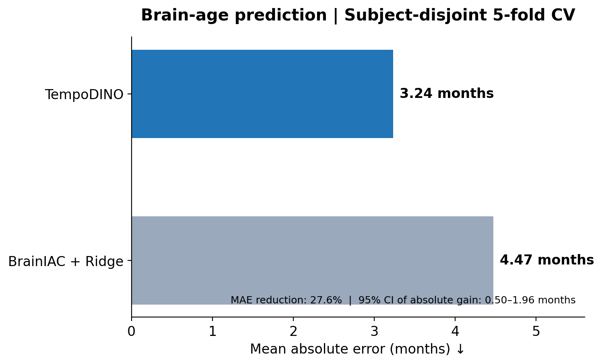
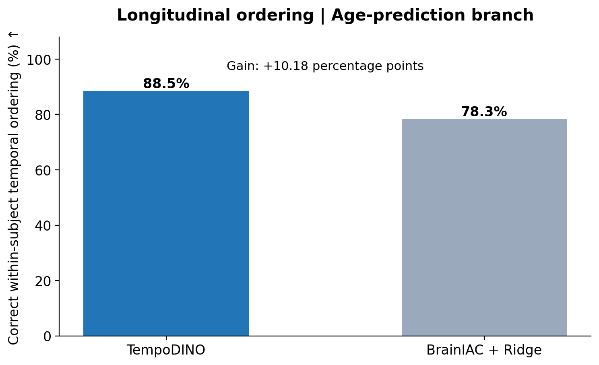
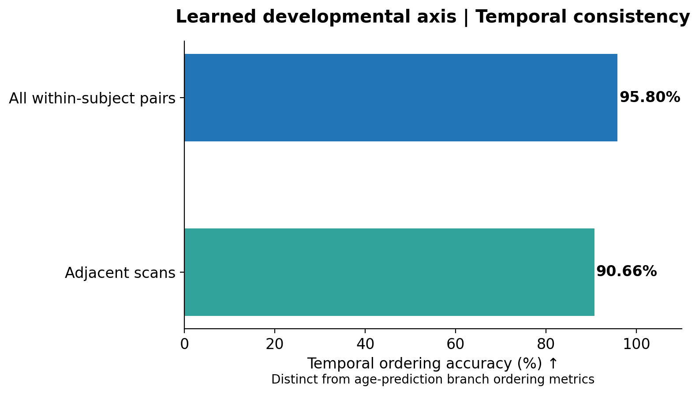

# TempoDINO — Main Experimental Results

TempoDINO learns developmental representations from longitudinal
macaque brain MRI.

**Dataset:** 23 macaques, 114 longitudinal T1-weighted MRI scans.

**Evaluation:** Subject-disjoint five-fold cross-validation.

## 1. Brain Age Prediction

TempoDINO achieved an MAE of 3.24 months, compared with
4.47 months for BrainIAC + Ridge.

## 2. Longitudinal Ordering

TempoDINO achieved 88.50% within-subject pairwise
age-ordering accuracy, compared with 78.32% for BrainIAC + Ridge.

## 3. Developmental Representation

The developmental axis achieved 95.80% pairwise ordering
accuracy and 90.66% adjacent-scan ordering accuracy.

These developmental-axis results are distinct from
age-prediction ordering metrics.
